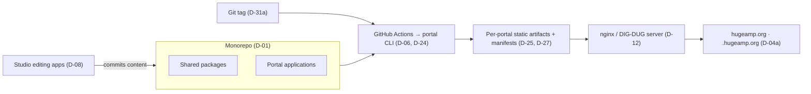
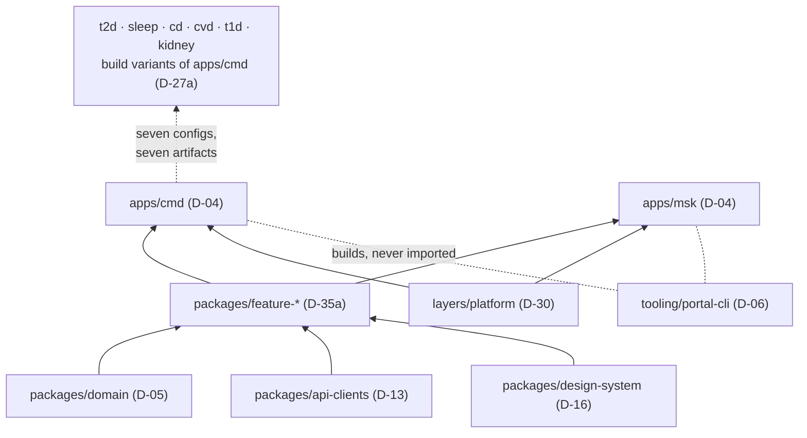
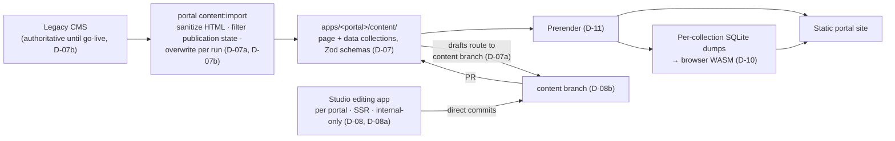
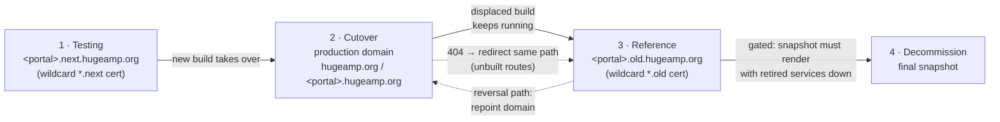
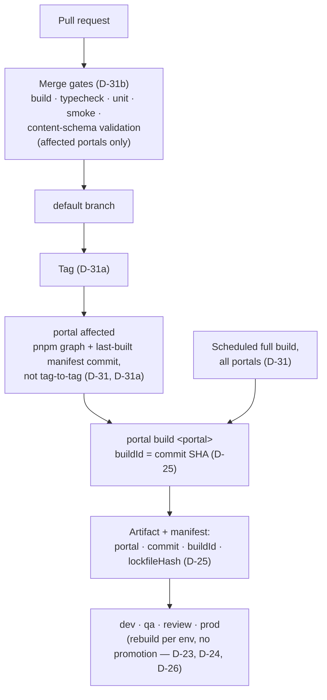

# DIG Portal rewrite — architecture

> Status: companion to [`decisions.md`](./decisions.md), which is authoritative. This document shows the decided **structure**; every element carries its decision ID (`D-nn`), and rationale lives with the decision, not here. If the two disagree, `decisions.md` wins.
>
> Date: 2026-08-13

## System at a glance

A **pnpm monorepo** (D-01, D-03) in a new successor repository (D-02), containing one **Nuxt 4 / Vue 3 / TypeScript** application per production portal (D-27, D-29), each compiled to a **prerendered static artifact with SPA fallback** (D-11) and served by nginx through the DIG-DUG server (D-12). Builds run from **tags** on **GitHub Actions** through a repository-owned **`portal` CLI** (D-06, D-24, D-31a). Content is **Git-managed Nuxt Content** (D-07) edited through per-portal **Nuxt Studio** deployments (D-08, D-08a); the legacy runtime CMS is retired portal-by-portal (D-07b). Version one is **CMD** (`hugeamp.org`) and **MSK** (D-04), built by a single architect with AI assistance (D-35a).



## Repository layout

```text
dig-portal-next/
  apps/
    cmd/                      # flagship; serves hugeamp.org (D-04, D-04a)
      app/
        components/           # portal-owned presentation (D-14, D-15)
        layouts/              # all layouts portal-owned — none shared (D-14)
        pages/
        app.config.ts         # Nuxt UI theme tokens ONLY (D-21, D-22)
      content/                # Nuxt Content collections (D-07)
      public/
      variants/               # md-family build configs: t2d, sleep, cd,
                              #   cvd, t1d, kidney (D-27a)
      content.config.ts
      nuxt.config.ts
      portal.config.ts        # THE portal definition — identity, features,
                              #   navigation (D-21)
    msk/                      # portal two; msk.hugeamp.org (D-04)

  layers/
    platform/                 # thin: bootstrap, baseline modules, error
                              #   shell — consumed via explicit extends,
                              #   declared as workspace package (D-30, D-31a)

  packages/
    domain/                   # framework-independent types and rules (D-05)
    api-clients/              # typed BioIndex clients; implementation-
                              #   neutral so BFF stays reversible (D-13)
    design-system/            # tokens + primitives on Nuxt UI — no shared
                              #   chrome (D-14, D-16)
    feature-*/                # headless composables + default renderers;
                              #   contribution surface (D-35a)

  tooling/
    portal-cli/               # the build contract (D-06)

  pnpm-workspace.yaml
  pnpm-lock.yaml              # single lockfile (D-03)
```

## Dependency graph

One direction only: applications compose shared packages; shared packages never import an application and never read a portal ID (D-05). Enforced by pnpm workspace boundaries, lint, and `CODEOWNERS` (D-35a).



**The md-family variant rule (D-27a):** a variant may own theme tokens, phenotype subset, content directory, landing composition, and layout *selection* — everything it uses must exist inside `apps/cmd`. A variant needing unique capability graduates to its own `apps/` directory.

## Content pipeline

The runtime CMS is retired (D-07). Until a portal goes live the CMS remains the authoritative, editable source; imports overwrite freely (D-07b). After go-live, Studio is the only authoring surface.



Key properties:

- **Sanitization is a blocking step in the import** — tag/attribute/URL-scheme allowlists, malicious-content fixtures in build tests (D-07b). The Studio component allowlist (D-08c) governs component insertion; it does not sanitize.
- **Unpublished content never enters a public build**; drafts live on the content branch, previewed behind nginx auth (D-07a).
- **One Studio instance per portal** — `repository.rootDir` is a single string; verified against module source (D-08a). Media commits to `<portal>/public`, 10 MB cap, external blob only if growth demands it (D-08d).
- **Editorial vs application**: prose in page collections, research-page composition in schema-validated data collections (D-09).

## Portal domain lifecycle

Each portal moves through four stages independently (D-38, D-38b). There is no parity gate (D-20, D-38); reversal is a routing change back to a deployment that never stopped running.



- Final content refresh runs minutes before cutover; after it, Studio is the sole source (D-07b).
- The 404-fallback redirect keeps bookmarks working and its log is a passive inventory of unbuilt routes with real traffic (D-38b).
- Stage 4 is gated: prove the snapshot renders with the CMS and other retired services unavailable — keep the CMS read-only meanwhile, or flatten CMS-dependent pages to static HTML first (D-38b).
- The old setup retires when every necessary portal has a new version; no cutoff date (D-38a).

## Build and delivery



- Deliberately **not** gates: coverage thresholds, visual regression (D-31b).
- Affected calculation requires the platform layer be a declared workspace dependency — relative-path `extends` is invisible to the pnpm graph (D-31a).
- Environment config is baked at build time; no artifact promotion (D-23, D-24).
- The prototype sandbox is a separate repository scaffolded by the `portal` CLI from `apps/*`, outside this pipeline entirely (D-28).

## State and configuration

| Concern | Home | Decision |
| --- | --- | --- |
| Portal identity, features, navigation | `portal.config.ts` | D-21 |
| Theme tokens | `app.config.ts` (Nuxt UI / Tailwind v4 `@theme`) | D-16, D-22 |
| Route/filter state | URL and query parameters | D-20a |
| Page request data | `useFetch` / `useAsyncData` | D-20a |
| Feature workflow state | Feature-scoped Pinia stores | D-20a |
| API transport and caching | `api-clients` abstraction, not stores | D-20a |
| Server-only secrets | Private `runtimeConfig`, never client code | D-22 |
| Deployment metadata | Generated build manifest | D-25 |

## What is deliberately absent

- **Shared layouts and shared chrome** — every layout and presentation surface is portal-owned (D-14, D-15).
- **A Nuxt BFF** — allowed only if a spike justifies it; API clients stay implementation-neutral (D-13).
- **Error monitoring and production source maps** — deferred as a stated trade (D-32, D-33).
- **CSP** — deferred past v1; the future design (nginx report-only header + nuxt-security SSG hashes) is recorded in O-10 (closed).
- **Coverage targets and visual regression** — not merge gates (D-31b).
- **Internationalization** (D-18); **artifact promotion** (D-24); **portal branches** (D-39 rule 1).

## Version-one sequence

Foundation first (D-35), in dependency order (O-01): repo + `portal` CLI → application shell → data layer → content pipeline → prerender-safety conventions (established when the first browser-only visualization is rebuilt). Then CMD, with MSK added before CMD is feature-complete (D-36). The locus plot ships later and gates nothing (D-20). CFDE is planned as a monorepo portal, scheduled after the section library matures (O-15).
