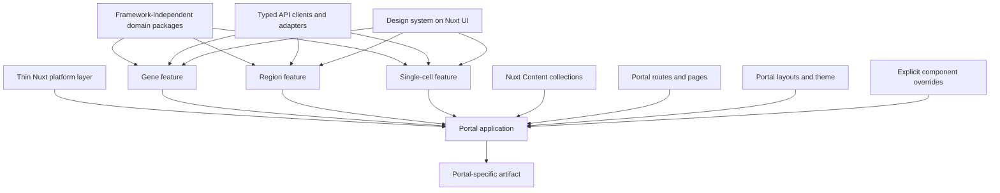
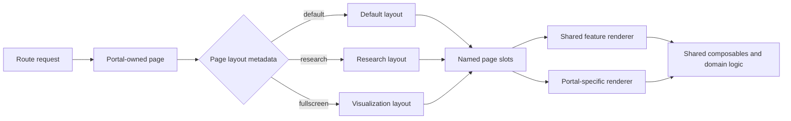
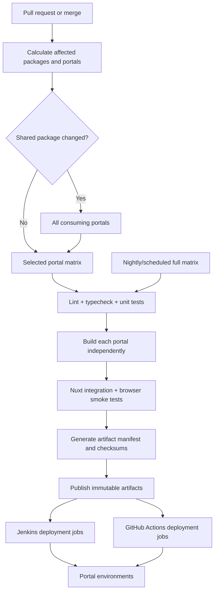
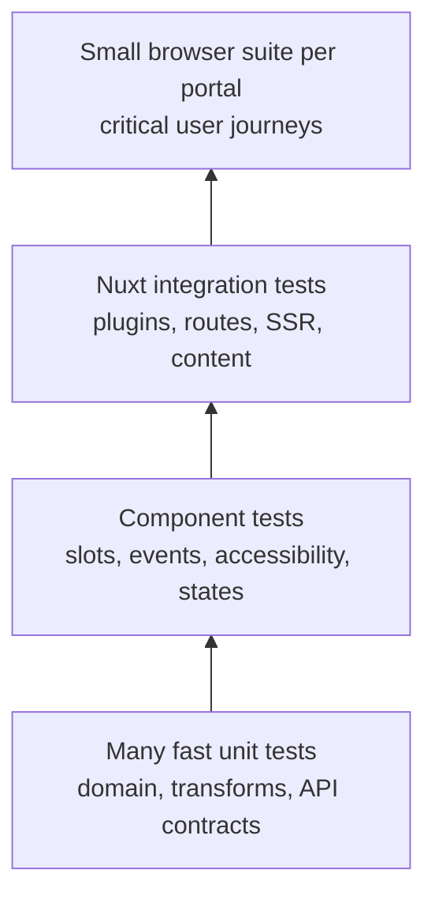

# DIG Portal rewrite architecture brainstorming

> **Superseded in part — read [`decisions.md`](./decisions.md) first.** (Banner added 2026-08-12; the rest of this file is unchanged.)
>
> This is an append-only working record of three sessions: the original proposal, a review dated 2026-08-01, and a decisions log. Earlier sections were never amended when later sections overrode them, so this file gives contradictory answers on repository topology, Nuxt Content Studio, shared application chrome, and locus-plot handling.
>
> `decisions.md` is the authoritative current state and lists exactly what here is superseded. Keep this file for rationale, evidence, and the reasoning trail.

> Status: working notes for review, not an accepted architecture decision record (ADR).
>
> Scope: a new implementation. The current Vue 2.7 application remains maintained as-is; this is not a migration plan and should not constrain the new source structure.

## Executive direction

The leading option is a **monorepo containing independently composed and independently deployable Nuxt portal applications**. Shared code should be organized into deliberately bounded platform, design-system, domain, and feature packages. Portal-specific pages, layouts, themes, and components should be normal first-class code under each portal application—not Git branch differences and not a growing collection of `if (portal === ...)` conditions.

The proposed stack to validate is:

- Vue 3 and TypeScript.
- Nuxt 4 as the application framework and build system.
- Pinia for durable client-side and cross-page application state.
- Nuxt UI for accessible UI primitives and application-shell components.
- Nuxt Content for schema-validated, Git-managed editorial content.
- A workspace-capable package manager and a single repository lockfile.
- Vitest, `@nuxt/test-utils`, Vue Test Utils, and Playwright for layered testing.

Nuxt 4 should still be treated as a decision to prove, not a foregone conclusion. Its value is strongest if the portals benefit from layouts, routing, content rendering, SEO, server rendering/pre-rendering, and an optional server/BFF layer. If the deployment must remain a purely client-rendered static application and Nuxt Content is not adopted, a Vue 3 + Vite application would have less framework and operations surface.

## Confirmed context and requirements

### Product and lifecycle

- The existing application remains on Vue 2.7.
- The new application is a complete rewrite, not a Vue migration.
- Existing Vue components should be treated as behavior/reference material, not code that must be mechanically ported.
- Some current dependencies and visualization integrations have no practical migration path. Alternatives or isolated adapters will be needed.
- Portal differences are legitimate product requirements. A variant is not necessarily technical debt merely because it is different.

### Customization

- Each portal must be able to choose and customize its application shell.
- Each page must be able to select a layout.
- Portals must be able to supply portal-specific layouts.
- Portals must be able to replace selected feature and UI components.
- A page must be able to compose shared and portal-specific sections without copying an entire shared page.
- Themes, navigation, content, routes, data sources, and enabled features may differ by portal.
- Truly divergent behavior should be allowed to remain separate while sharing lower-level domain logic and API contracts.

### Repository and ownership

- Long-lived portal branches should not be the product-variation mechanism in the rewrite.
- Different teams may primarily own different portals.
- Teams need isolation for portal work without losing atomic shared-package changes.
- Shared packages must never import from a portal application.
- Portal applications may import shared packages and explicitly provide portal implementations of extension contracts.
- Ownership should be enforceable with `CODEOWNERS` and package/application boundaries.

### Build and delivery

- Portals are independently buildable and deployable.
- Jenkins currently builds most portals; GitHub Actions builds some.
- Jenkins and GitHub Actions must invoke the same repository-owned commands rather than reimplement build knowledge in pipeline files.
- A shared change must identify and validate every affected portal.
- Each build must produce an immutable, identifiable portal artifact.
- The process must support different deployment schedules without requiring separate source branches.
- Developers must be able to reproduce CI builds locally.

### Quality attributes

- Reproducible builds from a single lockfile and pinned Node/package-manager versions.
- Type-safe configuration and extension contracts.
- Strong accessibility defaults and automated checks.
- Clear server/client boundaries for SSR safety.
- Fast affected-portal feedback with a scheduled safety build of all portals.
- Testable domain logic without requiring a Nuxt runtime.
- Observable deployments carrying portal ID, commit, configuration version, and artifact metadata.

## Non-goals

- Preserving the current folder structure.
- Translating every Vuex module into a Pinia store.
- Producing one universal portal bundle containing every portal's code.
- Forcing portals with different requirements to use identical page components.
- Publishing internal packages to a registry unless another repository actually needs to consume them.
- Hiding product differences behind implicit layer precedence.
- Replacing scientific visualization libraries with Nuxt UI; Nuxt UI and visualization components solve different problems.

## Relationship to the current Vue 2 application

The cleanest boundary is likely **one new repository for the rewrite, containing all new portal applications**, while the existing repository continues to maintain all Vue 2 portals. That is different from creating one repository per portal.

- Do not attempt to make Vue 2 and Vue 3 share live component packages.
- Reuse API contracts, observed behavior, test cases, terminology, and visual references rather than framework code by default.
- Run old and new deployments side by side while portals are reimplemented.
- Cut over one portal or route group at a time only if DNS/server routing supports a clear rollback.
- Give rewritten routes explicit parity criteria: supported URLs, query parameters, redirects, analytics, accessibility, data exports, and error behavior.
- Keep the new monorepo's release history and dependency graph independent from emergency maintenance of the Vue 2 application.
- Decide whether the new repository replaces this repository at final cutover or remains a successor with a distinct name; this is a governance decision, not a code-architecture requirement.

## Architecture options

| Option                                                      | Portal autonomy | Shared changes                   | Build consistency | Main concern                                            |
| ----------------------------------------------------------- | --------------- | -------------------------------- | ----------------- | ------------------------------------------------------- |
| Long-lived portal branches                                  | High            | Manual merge-down                | Low               | Current drift repeats                                   |
| Separate portal repositories plus published shared packages | Very high       | Version and release coordination | Medium            | Shared changes cannot be atomic                         |
| One configurable multi-tenant application                   | Medium          | Excellent                        | Excellent         | Portal-specific code and bundle size can become tangled |
| Monorepo with separate portal apps and shared packages      | High            | Atomic and reviewable            | Excellent         | Requires boundary and ownership discipline              |

**Leading option:** monorepo with separate portal applications and shared packages.

Separate repositories should be reconsidered only if portals require separate access control, legal boundaries, unrelated release governance, or teams that cannot coordinate through one repository. Different Jenkins jobs alone are not a reason to use separate repositories.

## Proposed repository shape

```text
dig-portal-next/
  apps/
    a2f/
      app/
        assets/
        components/
        layouts/
        middleware/
        pages/
        plugins/
        stores/
        app.config.ts
        app.vue
      content/
      public/
      server/                 # only when this portal needs server routes
      content.config.ts
      nuxt.config.ts
      portal.config.ts
      package.json
      tests/
    cfde/
    matkp/
    pankbase/
    radiant/
    sysbio/

  layers/
    platform/                 # thin shared Nuxt defaults and app bootstrap
      app/
      server/
      nuxt.config.ts

  packages/
    design-system/            # DIG semantics built on Nuxt UI
    domain/                   # framework-independent types and rules
    api-clients/              # BioIndex/CMS/etc. clients and contracts
    feature-gene/
    feature-phenotype/
    feature-region/
    feature-variant/
    feature-single-cell/
    feature-pigean/
    feature-knowledge-graph/
    observability/
    test-support/

  tooling/
    portal-cli/
    eslint-config/
    typescript-config/
    build-manifest/

  package.json
  workspace.yaml              # exact name depends on package manager
  lockfile
```

Nuxt 4 uses `app/` as its default application source directory and keeps `server/`, `shared/`, `layers/`, and `public/` at the application root. See the [Nuxt 4 directory structure](https://nuxt.com/docs/4.x/getting-started/upgrade#new-directory-structure).

## Composition model



The important dependency rule is one-directional: portal applications compose shared capabilities; shared packages do not inspect or import portal applications.

## Nuxt Layers: use narrowly and intentionally

[Nuxt Layers](https://nuxt.com/docs/4.x/getting-started/layers) can share configuration, components, composables, layouts, middleware, utilities, and server code. A portal app can extend the platform layer:

```ts
// apps/matkp/nuxt.config.ts
export default defineNuxtConfig({
  extends: ["../../layers/platform"],
});
```

Project files have higher priority than layer files, so a portal can override a default layout or component. That is useful, but unrestricted filename-based shadowing could recreate the current branch problem in a less visible form.

Recommended division of responsibility:

| Mechanism          | Use it for                                                                        | Do not use it for                              |
| ------------------ | --------------------------------------------------------------------------------- | ---------------------------------------------- |
| Nuxt layer         | Bootstrap, baseline modules, error shell, default layout, shared Nuxt conventions | A deep stack of portal and feature overrides   |
| Nuxt module        | Explicit installation of a feature or cross-cutting integration                   | Ordinary domain functions                      |
| Workspace package  | Domain types, API clients, composables, headless behavior, reusable UI            | Portal-specific page composition               |
| Portal application | Routes, pages, layouts, theme, content, feature selection, overrides              | Code expected to be imported by another portal |

Caveats:

- Layer order is significant; auto-registered layers are alphabetically prioritized.
- File collisions are implicit. Maintain an automated report of files a portal shadows from the platform layer.
- Prefer explicit component/feature contracts when the difference is intentional product behavior.
- Avoid remote Git layers initially. Local workspace sources keep builds reproducible and changes atomic.

## Portal definition and extension contracts

Each portal should export a typed definition. Exact implementation needs a spike because Nuxt file-based routing and static analysis must still be respected.

```ts
export interface PortalDefinition {
  id: PortalId;
  displayName: string;
  features: FeatureRegistration[];
  navigation: NavigationDefinition;
  components: Partial<PortalComponentOverrides>;
  capabilities: PortalCapabilities;
}

export interface PortalComponentOverrides {
  pageHeader: Component;
  pageFooter: Component;
  globalSearch: Component;
  geneResults: Component;
  singleCellViewer: Component;
}
```

Guidelines:

- Keep the override list explicit and typed; do not introduce a string-to-any-component service locator.
- Define overrides at meaningful feature boundaries, not for every button and internal element.
- Use props, events, and slots for local customization.
- Use an override contract when a portal must replace a whole capability renderer.
- Let different feature renderers share headless composables, data models, and API adapters.
- Do not make shared components read portal IDs and branch internally.

## Page and layout customization

Nuxt provides named layouts selected through `definePageMeta`. Layouts are asynchronously loaded when used. See [Nuxt layouts](https://nuxt.com/docs/4.x/directory-structure/app/layouts).

```vue
<!-- apps/matkp/app/pages/gene/[symbol].vue -->
<script setup lang="ts">
definePageMeta({ layout: "research" });
</script>

<template>
  <GenePageShell>
    <template #summary>
      <MatGeneSummary />
    </template>

    <template #primary>
      <GeneAssociations />
    </template>

    <template #aside>
      <MatGeneResources />
    </template>
  </GenePageShell>
</template>
```



Suggested layout set to validate:

- `default`: header, navigation, content, footer.
- `content`: reading width, table of contents, editorial navigation.
- `research`: wide data layout with optional filters and side panel.
- `fullscreen`: visualization workspace with minimal chrome.
- Portal-owned additions where these do not fit.

Do not create one highly parameterized layout with dozens of boolean props. A small number of coherent layouts is easier to understand and test.

## Component architecture

Use three levels rather than treating all `.vue` files as equally shareable:

1. **Primitives** — buttons, fields, dialogs, tables, tabs, accessible interactions. Prefer Nuxt UI directly.
2. **DIG semantic components** — `PhenotypePicker`, `DatasetStatus`, `ResearchFilterPanel`. Built using primitives and domain terminology.
3. **Feature/page renderers** — `DefaultSingleCellViewer`, `MatSingleCellViewer`, `CfdeSingleCellViewer`. These can legitimately differ.

A feature package can expose shared behavior and a default renderer:

```text
packages/feature-single-cell/
  src/domain/
  src/api/
  src/composables/
  src/stores/
  src/components/DefaultSingleCellViewer.vue
  src/contracts.ts
```

Portal-specific implementations remain in the portal:

```text
apps/pankbase/app/components/single-cell/PanKbaseSingleCellViewer.vue
apps/cfde/app/components/single-cell/CfdeSingleCellViewer.vue
```

This permits visual and interaction divergence without duplicating data fetching, validation, selection state, or plot-model generation.

## Nuxt UI strategy

[Nuxt UI](https://ui.nuxt.com/) provides accessible components based on Tailwind CSS and Reka UI, semantic color aliases, CSS-first theme tokens, component slots, variants, and global configuration through `app.config.ts`.

Recommended use:

- Use Nuxt UI directly for general-purpose primitives unless a DIG-specific semantic abstraction is needed.
- Put shared semantic design tokens in the platform/design-system package.
- Let each portal define brand tokens and deliberate component theme overrides.
- Prefer semantic tokens (`primary`, `error`, `muted`, `elevated`) over raw portal color names in feature packages.
- Create wrappers when they enforce domain semantics, accessibility, analytics, or a stable product contract—not merely to rename every Nuxt UI component.
- Treat plots, genome browsers, network graphs, and high-volume scientific tables as feature components, not Nuxt UI responsibilities.

Example portal theme direction:

```ts
// apps/matkp/app/app.config.ts
export default defineAppConfig({
  portal: {
    id: "matkp",
    displayName: "Musculoskeletal Knowledge Portal",
  },
  ui: {
    colors: {
      primary: "blue",
      neutral: "slate",
    },
  },
});
```

Caveats:

- Nuxt UI introduces Tailwind CSS conventions. Agree on when utility classes, component variants, and scoped CSS are appropriate.
- Per-component `ui` overrides are powerful but can create unreviewable one-off styling. Prefer named design-system variants for repeated patterns.
- Validate keyboard interaction, focus management, screen-reader behavior, contrast, dense scientific tables, and charts in the application context; a component library does not eliminate application-level accessibility work.
- Record the chosen Nuxt UI major version and upgrade policy in an ADR once the spike is complete.

## Pinia and data-state boundaries

[Pinia supports Nuxt 3 and 4](https://pinia.vuejs.org/ssr/nuxt.html), and Nuxt handles the core SSR serialization concerns. That does not mean all fetched data belongs in Pinia.

Recommended state split:

| State                                  | Preferred mechanism                                         |
| -------------------------------------- | ----------------------------------------------------------- |
| Route parameters and shareable filters | URL/query parameters                                        |
| SSR/page request data                  | `useFetch` / `useAsyncData`                                 |
| Local component state                  | `ref`, `reactive`, local composables                        |
| Cross-component feature workflow       | Feature-scoped Pinia store                                  |
| Cross-page user preferences            | Pinia plus an explicit persistence adapter                  |
| API transport/cache policy             | API client/query abstraction, not a global store by default |

Guidelines:

- Use setup-style, feature-scoped stores rather than a single portal store.
- Stores may import domain packages, but presentation components should not require knowledge of unrelated stores.
- Keep SSR-hydrated state serializable and intentionally small.
- Avoid fetching the same resource once through `useAsyncData` and again through a store action.
- Use Pinia's Nuxt-aware patterns such as `callOnce` only after defining ownership of the data and refresh behavior.
- Do not translate the current Vuex tree one-for-one. Design stores around new workflows.

## Nuxt Content strategy

[Nuxt Content collections](https://content.nuxt.com/docs/collections/define) support page and data collections, schema validation, type inference, and typed queries. They are a promising fit for:

- About, help, policies, collaboration, and methodology pages.
- Portal documentation and tutorials.
- Release notes and curated news when Git-based authoring is acceptable.
- Publication summaries and other editorial metadata.
- Structured navigation or resource lists that benefit from schema validation.

Example direction:

```ts
// apps/matkp/content.config.ts
import { defineCollection, defineContentConfig, z } from "@nuxt/content";

export default defineContentConfig({
  collections: {
    pages: defineCollection({
      type: "page",
      source: "pages/**/*.md",
      schema: z.object({
        audience: z.enum(["public", "researcher", "developer"]),
        reviewedAt: z.date(),
        owner: z.string(),
      }),
    }),
    resources: defineCollection({
      type: "data",
      source: "resources/**/*.{json,yml,yaml}",
      schema: z.object({
        title: z.string(),
        href: z.string(),
        category: z.string(),
      }),
    }),
  },
});
```

Do not use Nuxt Content as a replacement for:

- BioIndex or scientific query APIs.
- Frequently changing operational data.
- User-generated or transactional data.
- Content requiring complex live editorial workflows unless Nuxt Content Studio is separately evaluated and approved.

Caveats:

- Content v3 creates collection data through a SQLite-backed storage pipeline. Deployment behavior and cold starts must be tested on the actual Jenkins/GitHub deployment targets. See the [Nuxt Content database architecture](https://content.nuxt.com/docs/advanced/database).
- Git-managed content changes normally flow through review and another build/deployment. Confirm whether content editors accept that latency.
- A document should belong to only one collection; overlapping source patterns can cause live-reload problems.
- Remote content sources introduce credentials, availability, and build-reproducibility concerns.
- Define which MDC/custom components authors may invoke. Treat embedded HTML and remote content as a security boundary.
- Decide whether content is portal-owned, globally shared, or explicitly imported from a shared collection. Do not rely on accidental file shadowing.

## Rendering and deployment modes

Nuxt can produce a Node/Nitro server, pre-rendered static output, a client-rendered SPA, or hybrid behavior. See [Nuxt deployment options](https://nuxt.com/docs/4.x/getting-started/deployment).

| Mode                         | Advantages                                                | Caveats                                                                 | Likely fit                              |
| ---------------------------- | --------------------------------------------------------- | ----------------------------------------------------------------------- | --------------------------------------- |
| SSR on Node/Nitro            | SEO, server data access, BFF routes, per-request behavior | New runtime operations, scaling, monitoring, server security            | Public content plus server needs        |
| Pre-render/static generation | Simple hosting, fast content pages                        | Dynamic route enumeration, build-time content, browser API calls remain | Mostly static portal shell/content      |
| SPA (`ssr: false`)           | Closest operational model to current frontend             | Less useful first render/SEO, Nuxt server features reduced              | Highly interactive authenticated tools  |
| Hybrid route rules           | Optimize content and interactive routes differently       | More modes to reason about and test                                     | Potentially best, after a focused spike |

Questions to settle per portal:

- Are public pages indexed by search engines?
- Does the current DIG-DUG server need to serve/proxy the Nuxt output?
- Can the deployment run a Node process, or only static assets?
- Are there request-time secrets or authenticated upstream calls?
- How are unknown dynamic gene/variant/region URLs handled?
- Can portal content updates wait for a rebuild?

Visualization caveats:

- Browser-only libraries must not execute DOM or `window` access during SSR.
- Use client-only boundaries and lazy imports narrowly around the incompatible visualization, not around the entire page.
- SSR and hydration should be tested with a representative LocusZoom/genome browser, WebGL plot, network graph, and large table before choosing the default mode.
- Check bundle size and memory behavior independently for every portal; separate app builds should not include unused portal features.

## API and optional backend-for-frontend boundary

Nuxt server routes could act as a small backend-for-frontend (BFF), but this should be an explicit decision.

Possible BFF responsibilities:

- Same-origin proxying and credential protection.
- Request normalization across upstream APIs.
- Server-side caching and response shaping.
- Combining a small number of upstream calls for page rendering.
- Stable portal-facing error contracts and observability.

Responsibilities that should remain in the existing backend/data services:

- Scientific computation.
- Long-running workflows.
- Primary authorization policy.
- Canonical data persistence.
- Large query engines already served by BioIndex or related services.

Define typed API client interfaces independently of whether the implementation calls an upstream service from the browser or through a Nitro server route. This keeps the deployment decision reversible.

## Configuration model

Nuxt distinguishes build-time `app.config.ts` from environment-overridable `runtimeConfig`. See [Nuxt configuration guidance](https://nuxt.com/docs/4.x/getting-started/configuration#runtimeconfig-vs-appconfig).

Suggested split:

| Configuration                                            | Location                                              |
| -------------------------------------------------------- | ----------------------------------------------------- |
| Portal ID, enabled features, navigation, theme structure | Portal source / `app.config.ts`                       |
| Public API base URLs varying by environment              | Public runtime configuration                          |
| Server-only credentials                                  | Private `runtimeConfig`; never exposed to client code |
| Deployment and artifact metadata                         | Generated build manifest                              |
| Emergency operational feature switch                     | External runtime configuration/service, if required   |

Caveat: a fully static artifact cannot receive new server environment variables after deployment. If the same static artifact must be promoted through environments, load a validated public `/portal-runtime-config.json` before application startup or use environment-neutral same-origin URLs. Never put secrets in that file.

## Unified build interface

The repository should own a provider-neutral portal CLI:

```text
portal list
portal validate matkp
portal dev matkp
portal typecheck matkp
portal test matkp
portal build matkp
portal package matkp
portal affected --base <sha> --head <sha>
```

Jenkins and GitHub Actions should call those commands. They should not know Nuxt config paths, output directory conventions, feature dependency graphs, or artifact-manifest formats.

Each artifact should include something similar to:

```json
{
  "portal": "matkp",
  "commit": "<git-sha>",
  "buildId": "<ci-build-id>",
  "createdAt": "<ISO-8601>",
  "nodeVersion": "<version>",
  "packageManagerVersion": "<version>",
  "lockfileHash": "<sha256>",
  "portalConfigHash": "<sha256>",
  "renderingMode": "<ssr|static|spa|hybrid>"
}
```

Use portable Node/TypeScript scripts. Avoid embedding Bash-specific `export` expressions or PowerShell-specific setup in package scripts.

## CI/CD flow



Recommended checks:

### On every pull request

- Validate portal definitions and content schemas.
- Lint and type-check affected workspaces.
- Run domain and feature unit tests.
- Build every affected portal.
- Run smoke routes against built output.
- Report bundle-size changes by portal.
- Report layer shadows/component overrides.

### On the default branch

- Produce immutable artifacts only after the same validation.
- Sign or checksum artifacts where supported.
- Publish build manifests and source-map references.
- Promote an existing artifact rather than rebuilding it for each environment where possible.

### Scheduled safety job

- Build and smoke-test every portal.
- Validate external integration contracts against non-destructive endpoints.
- Check dependency and license/security status.
- Detect orphaned features, content, and portal configuration.

Affected-build logic must use the workspace dependency graph, not only path prefixes. A change in a shared package can affect portals whose directories did not change. A task orchestrator such as Nx or Turborepo can be evaluated if build time justifies it; do not add one before the repository's scripts and dependency boundaries are sound.

## Testing strategy

Nuxt has first-class integration with Vitest and `@nuxt/test-utils`; see the [Nuxt testing example](https://nuxt.com/docs/4.x/examples/advanced/testing) and [`@nuxt/test-utils`](https://nuxt.com/modules/test-utils).



Suggested layers:

- **Unit:** Vitest for framework-independent domain functions, adapters, filters, and plot-model generation.
- **Component:** Vue Test Utils/Vitest for semantic and feature components, including portal-provided implementations.
- **Nuxt integration:** `@nuxt/test-utils` for routing, layouts, plugins, server routes, SSR, and Nuxt Content behavior.
- **Browser:** Playwright for representative index, gene, phenotype, region, variant, content, and portal-specific workflows.
- **Visual regression:** selected layouts, navigation, dense tables, and important plots at agreed viewport sizes.
- **Contract:** captured schemas/fixtures for BioIndex and other external APIs without turning fixtures into unmaintainable full snapshots.

Avoid asserting implementation details of Nuxt UI. Test DIG behavior, accessible roles/names, state changes, emitted events, and rendered outcomes.

## Security, accessibility, and operations notes

- No secret can be present in `app.config`, public runtime config, generated client bundles, or Nuxt Content.
- Sanitize or disallow arbitrary HTML in content; maintain an allowlist of content-renderable components.
- Apply timeouts, abort signals, response validation, and consistent error mapping in API clients.
- Determine CSP requirements early because scientific visualizations, workers, WASM, remote assets, and analytics can affect policy.
- Capture portal ID, route, feature, upstream, correlation ID, and artifact commit in client/server error telemetry where privacy permits.
- Keep production source maps private or upload them directly to the selected error-monitoring system.
- Establish performance budgets per portal rather than one aggregate budget.
- Include keyboard-only and screen-reader checks in the definition of done for shared layouts and semantic components.
- Establish browser support before choosing visualization replacements and Tailwind targets.
- Pin the Node version, package-manager version, Nuxt minor line, and lockfile in CI. Do not use `latest` or opt into future Nuxt compatibility behavior implicitly during the rewrite.
- Define a routine dependency-upgrade window so framework updates are validated across all portal builds together.

## Governance rules to prevent the old architecture from returning

1. Portal variation lives in portal source, configuration, or an explicit extension contract—not a portal branch.
2. A shared package cannot reference a portal ID.
3. A feature package owns its domain/API boundary and may provide a default renderer.
4. Portal-specific renderers may share headless logic without being forced into one universal template.
5. Nuxt layer shadowing must be reported and reviewed.
6. Every shared-package change builds all consuming portals before merge.
7. Every portal has named owners and critical smoke routes.
8. Pipeline-provider configuration remains thin; repository commands are the source of truth.
9. Experimental framework options require an ADR and an exit plan.
10. Dependencies are added at the narrowest workspace that consumes them.

## Architecture spikes before committing

### Spike A: rendering and deployment

Build one public content page and one browser-heavy research page in SSR, static, and SPA modes. Measure:

- Artifact size and cold start.
- Initial render and hydration.
- Jenkins deployment compatibility.
- Runtime configuration behavior.
- Visualization/client-only complexity.
- Unknown dynamic route behavior.

### Spike B: portal customization

Implement the same feature in two deliberately different portals:

- Shared API client and headless composable.
- Shared default component for one portal.
- Portal-specific renderer and layout for the other.
- No portal checks inside the shared package.

The most different portals should be used for this spike. Two similar portals will not adequately test the extension model.

### Spike C: Nuxt Content

Validate:

- Per-portal and shared collections.
- Schema failures in CI.
- Static and SSR deployment outputs.
- Editorial preview workflow.
- Content-only change build time.
- MDC component allowlisting.
- SQLite behavior on the real hosting target.

### Spike D: build orchestration

Create one Jenkins job and one GitHub Actions job that both invoke the same CLI and produce byte-equivalent artifacts for the same commit, OS, Node version, and configuration. Differences should be explained in the manifest.

### Spike E: visualization compatibility

For each critical visualization class, identify:

- Vue 3-compatible replacement or wrapper.
- SSR/client-only behavior.
- TypeScript support.
- Accessibility fallback or equivalent data table.
- Export/download requirements.
- Expected dataset size and performance envelope.
- License and maintenance status.

## Open decisions for review

- [ ] One monorepo confirmed, or are there access/governance requirements requiring multiple repositories?
- [ ] Will the rewrite live in a new successor repository while the Vue 2 repository remains operational?
- [ ] npm, pnpm, or another workspace package manager?
- [ ] Default rendering mode: SSR, static, SPA, or hybrid?
- [ ] Can deployment targets run a Node/Nitro server?
- [ ] Will the existing DIG-DUG server proxy/host the new portals?
- [ ] Is a Nuxt BFF allowed, required, or prohibited?
- [ ] Which portals require independent access control or release approval?
- [ ] Which layouts are genuinely shared across the first two portals?
- [ ] Which component boundaries must be portal-replaceable in version one?
- [ ] Which current pages are editorial content versus application features?
- [ ] Who authors and approves Nuxt Content, and what publication latency is acceptable?
- [ ] What authentication and authorization model is required?
- [ ] What browsers, devices, and accessibility standard must be supported?
- [ ] Which visualization capabilities are mandatory for the first release?
- [ ] Which system owns analytics, error reporting, audit events, and consent?
- [ ] What constitutes artifact parity between Jenkins and GitHub Actions?
- [ ] Which deployment environments should promote the same artifact rather than rebuild?
- [ ] Are portal-specific domains selected at deployment, or is each portal compiled as a distinct application?

## Proposed initial decisions

These are starting recommendations for review, not final commitments:

1. Use a monorepo with one Nuxt application per deployable portal.
2. Produce a separate artifact per portal; do not ship every portal in one client bundle.
3. Use a thin local Nuxt platform layer plus explicit workspace feature packages.
4. Use portal-owned pages and layouts with typed, limited component override contracts.
5. Share domain logic and headless feature behavior before trying to share complete page templates.
6. Use Nuxt UI for primitives and shared application chrome, with portal theme tokens.
7. Use Pinia for cross-component workflows, not as the default data-fetching cache.
8. Use Nuxt Content only for editorial/structured content that fits a Git-reviewed publishing workflow.
9. Keep rendering mode and BFF adoption open until deployment and visualization spikes are completed.
10. Make the repository CLI the sole build contract used by Jenkins, GitHub Actions, and developers.

## Reference documentation

- [Nuxt 4 layers](https://nuxt.com/docs/4.x/getting-started/layers)
- [Nuxt 4 layouts](https://nuxt.com/docs/4.x/directory-structure/app/layouts)
- [Nuxt configuration](https://nuxt.com/docs/4.x/getting-started/configuration)
- [Nuxt deployment modes](https://nuxt.com/docs/4.x/getting-started/deployment)
- [Nuxt testing example](https://nuxt.com/docs/4.x/examples/advanced/testing)
- [Nuxt UI](https://ui.nuxt.com/)
- [Nuxt Content collections](https://content.nuxt.com/docs/collections/define)
- [Nuxt Content database architecture](https://content.nuxt.com/docs/advanced/database)
- [Pinia with Nuxt](https://pinia.vuejs.org/ssr/nuxt.html)
- [npm workspaces](https://docs.npmjs.com/misc/workspaces/)

---

# Review notes (2026-08-01)

> Appended review of the above document. Nothing above this line was modified. Claims were checked against this repository (`dig-dug-portal`, branch `rewrite-plans`, at commit `fe134c1ff`) and against current upstream documentation. Repository counts below are from `master` as checked out locally.

## Where this document is right, and the evidence supports it

These points are agreed and should not be relitigated in review.

1. **Branches are the wrong variation mechanism, and the scale confirms it.** `git branch -r` returns 141 remote branches, of which 16 match `*-main`. Eleven are live portal lines (`a2fkp`, `adipose_gw`, `cancerkp`, `cfde`, `cfde-liver`, `matkp`, `mouse`, `nephkp`, `pankbase`, `radiant`, `sysbio`) plus `master`. The merge-down model in `AGENTS.md` is real and is being carried by hand across twelve targets. The document's diagnosis is not theoretical.
2. **A monorepo with one application per deployable portal, plus bounded shared packages.** This is the right shape for the stated ownership and atomicity requirements, and the one-directional dependency rule (shared packages never import a portal, never read a portal ID) is the single most load-bearing rule in the document. Keep it as written.
3. **The repository should own the build contract.** This is stronger than the document claims. There are currently _no_ pipeline definitions in this repository at all — the only workflow file is `.github/workflows/codeql.yml`, and there is no `Jenkinsfile`. Every piece of build knowledge for every portal lives outside version control today. Moving that into a repository-owned CLI is not a refinement of the current process; it is the first time the build would be reviewable.
4. **Portable build scripts instead of shell-specific ones.** Also stronger than claimed, and there is a concrete precedent in `package.json`: all three of `watch`, `build`, and `deploy` begin with a bash `export NODE_OPTIONS=...` expression that does not run under PowerShell. This is a live Windows developer-machine failure today, not a hypothetical.
5. **Treat Vue 2 components as reference material, not a port target.** `src/components` holds 318 `.vue` files and `vue.config.js` declares 49 build entries. Mechanical porting at that volume would take longer than rewriting and would carry the existing structure forward.
6. **Typed, explicit override contracts instead of `if (portal === ...)`.** Correct, and the accompanying rule that shared components must not read portal IDs is what makes the contract meaningful rather than decorative.
7. **Nuxt UI for primitives, feature packages for scientific visualization.** Correct division, and there is no licensing obstacle: Nuxt UI is MIT, and as of v4 the former paid Pro tier is merged into the free library.
8. **The Nuxt 4 technical claims check out.** Verified against upstream: `app/` is the default `srcDir` with `server/`, `shared/`, `layers/`, `public/`, and `content/` at the project root; layers in `~~/layers` are auto-registered; Nuxt Content v3 is SQLite-backed; Pinia supports Nuxt 4 SSR. All twelve reference links resolve (see the correction to the npm one below).

## Factual corrections

### Byte-equivalent artifacts (Spike D) are not achievable as specified

Spike D asks two CI providers to "produce byte-equivalent artifacts for the same commit, OS, Node version, and configuration." Nuxt does not do this by default, and the document contradicts itself on the point.

- Nuxt assigns `buildId` a fresh `randomUUID()` for every production build unless `buildId` is set to a string in `nuxt.config`. Pinning it (to the Git SHA, for example) is a supported first-class code path, so this part is fixable — but it must be an explicit configuration decision, not an assumption.
- Beyond `buildId`, Nitro writes wall-clock timestamps into `nitro.json` and into server-asset and public-asset `mtime` values. The upstream request for `SOURCE_DATE_EPOCH` support (nitrojs/nitro#2645) is still open, so there is no supported deterministic-build story even with `buildId` pinned.
- The artifact manifest proposed in the same document includes `"createdAt": "<ISO-8601>"`. If that manifest ships inside the artifact, byte-equivalence is impossible by construction.

Suggested restatement of the Spike D success criterion: both providers produce artifacts whose **content hashes match over a normalized file set** (manifest and known timestamp fields excluded), with `buildId` pinned to the commit SHA and every remaining difference enumerated and explained in the manifest.

### Nuxt version posture needs a date-aware statement

Nuxt 4 is current (`nuxt@4.5.1`, published 2026-07-27) and Nuxt 5 has not shipped, but Nuxt 5 (Nitro v3) is in stabilization and is already reachable via `future.compatibilityVersion: 5`. Nuxt 3 reached end of life on **2026-07-31** — the day before this review. A rewrite starting now will very likely land during the 4-to-5 transition. The document's rule against opting into future compatibility behavior implicitly is correct and now has a concrete flag to name; the ADR should additionally state the intended Nuxt 5 adoption posture up front rather than discovering it mid-rewrite.

### The Tailwind caveat understates the change

The Nuxt UI section says the library "introduces Tailwind CSS conventions." Nuxt UI v4 (latest `4.10.0`) requires **Tailwind CSS v4** specifically, which is CSS-first: theme configuration moves into `@theme` blocks in CSS and there is no `tailwind.config.js`. That is a different authoring model, not a set of conventions, and it interacts directly with the document's "portal brand tokens" plan. Worth naming explicitly so nobody plans around Tailwind v3 examples.

### Nuxt Content storage is broader than SQLite, and the SPA case has a payload cost

Two additions to the Nuxt Content caveats and to Spike C:

- Content v3 supports **sqlite (default), d1, postgres, libsql, and pglite** adapters. Adapter selection is part of the deployment decision, not an afterthought — file-based SQLite does not persist on stateless serverless targets.
- In static and SPA modes, the client downloads a **WASM SQLite dump** on the first client-side content query. That is a bundle-and-latency cost the rendering-mode table does not currently list under the SPA row, and it should be measured in Spike A rather than discovered later.

### One broken-ish reference link

`https://docs.npmjs.com/misc/workspaces/` is a legacy meta-refresh stub that redirects to `/cli/v12/using-npm/workspaces/`. Use the versioned URL. All other reference links resolve correctly, including the layouts link.

### Layer priority wording is ambiguous

"Auto-registered layers are alphabetically prioritized" is true but reads backwards: alphabetically **later** wins (Z outranks A), which is why the `1.base` / `2.theme` naming convention exists upstream. Also note that auto-registration applies to a `~~/layers` directory _inside an application_; the proposed root-level `layers/platform` in a monorepo is consumed through an explicit `extends`, so the auto-registration ordering caveat does not apply to it as written. Both mechanisms may end up in play — say which one governs.

## Gaps, in order of how much they would change the plan

### 1. The document ignores the existing runtime CMS, which is the second variation mechanism

This is the most significant omission. The document treats Git branches as the only way portals vary today. They are not.

- `src/modules/hugeampkpncms.js` fetches whole page definitions at runtime: `getResearchPage`, `getResearchDevPage`, `getResearchMode`, `getResearchMenu`, `getResearchMethod`, `getResearchData`.
- `src/views/RPIndex/Template.vue` links users to `https://hugeampkpncms.org/user` with the label "Login to configure" and to a tutorial for building these pages.
- 34 source files reference the CMS host, including `PageHeader.vue`, `PageFooter.vue`, `PageFooter`/`PaperPageFooter`, the front-page news feed, and dataset pages.
- `src/components/researchPortal` contains 136 `.vue` files that exist to render those runtime configurations.

So today, non-developers author and reconfigure entire research pages at runtime, without a build. The proposed model — portal-owned pages in Git plus Nuxt Content with a review-and-rebuild publishing workflow — removes that capability for those users. The document's Nuxt Content caveat ("confirm whether content editors accept that latency") is aimed at editorial pages and does not reach the real problem, which is that page _composition_ is currently a runtime authoring product.

This needs an explicit decision before the architecture is accepted, with three honest options: keep the CMS as a runtime data source that the new portals consume; replace runtime page authoring with Git-based composition and accept the workflow loss; or run both, with Nuxt Content for editorial pages and a preserved runtime configuration path for research pages. The choice also constrains the `PortalComponentOverrides` contract, because `pageHeader`, `pageFooter`, and navigation are CMS-driven today rather than code-driven.

### 2. The portal count in the repository shape understates the scope

`apps/` lists six portals (`a2f`, `cfde`, `matkp`, `pankbase`, `radiant`, `sysbio`). The live portal branches number twelve including `master`, and `AGENTS.md` separately tracks seven. The gap matters because the document's own rules make CI cost scale with portal count: "every shared-package change builds all consuming portals before merge" and "each portal has named owners and critical smoke routes." Twelve portals × build + smoke + Playwright is a materially different budget from six, and the owner list is a staffing question, not a configuration one. Either enumerate the real target set or state explicitly that the first release covers a named subset.

### 3. There is no sequencing, ownership, or definition of "version one"

The document ends with five spikes and nineteen open decisions, none of which has an owner, a timebox, an ordering, or a stated dependency on the others. Spike B calls for "the most different portals" without naming them. Nothing states which portal is rewritten first or what the first release must contain. As written this is an architecture description, not a plan that can be started on Monday. A short section giving spike order, owner, timebox, the first portal, and the version-one feature set would make the rest actionable.

### 4. Two overlapping portal configuration surfaces

`portal.config.ts` appears in the repository shape tree but is never defined or referenced again. `PortalDefinition` is specified as an interface with no statement of which file exports it or how Nuxt consumes it. Separately, `app.config.ts` is shown carrying `portal.id` and `portal.displayName`. That is two or three places a portal identity could live. Pick one and delete the others from the document; the spike note ("exact implementation needs a spike because Nuxt file-based routing and static analysis must still be respected") is the right instinct but should not leave three candidate surfaces standing in the meantime.

### 5. Shared Nuxt Content collections across applications are not a solved path

The layer/package table forbids "portal-specific page composition" in workspace packages, while the Content section leaves collection ownership open between portal-owned, globally shared, and imported-from-shared. Content collections are configured per application in `content.config.ts`; sharing one collection across sibling applications in a monorepo is not a documented upstream pattern. This belongs in Spike C as a constraint to prove, not in the open-decisions list as a preference to choose.

### 6. Capture the current URL inventory before the rewrite, not during it

The document lists parity criteria (supported URLs, query parameters, redirects, analytics, accessibility, data exports, error behavior) but never says to produce the inventory. With 49 build entries on `master` alone, multiplied across portals, plus runtime CMS-defined research routes, that inventory is cheap to generate now from `vue.config.js` and the CMS, and effectively impossible to reconstruct after the Vue 2 application is retired. Make it a deliverable with a date.

## Smaller inconsistencies

- **Composition-model diagram.** `Routes --> Portal`, `Layouts --> Portal`, and `Overrides --> Portal` draw routes, layouts, and overrides as external inputs to the portal application, while the surrounding prose places all three _inside_ it. Either redraw them as contents of the portal node or drop them from the diagram.
- **Testing strategy has no thresholds.** No coverage targets, no statement of which layers gate a merge, and "visual regression" names no tool and no baseline-storage plan. Baseline management is a real recurring cost across a twelve-portal matrix and should be priced before it is adopted.
- **Static artifact promotion versus manifest fidelity.** The configuration section correctly solves environment promotion for static artifacts via a validated public `/portal-runtime-config.json`. Note the consequence: once that file exists, the manifest's `portalConfigHash` no longer fully identifies runtime behavior, because behavior depends on a file fetched after deployment. The manifest should record that the portal uses external runtime configuration.
- **Authentication is partly already decided.** It is listed as an open decision, but CMS login, user-configured research pages, and BYOR imply an existing account model. The open decision should be narrowed to whether the new portals adopt that model or replace it.
- **Internationalization is absent.** Probably correct to exclude, but say so explicitly as a non-goal rather than leaving it unmentioned.

## Suggested additions to the open-decisions list

- [ ] Does runtime CMS-driven page authoring survive the rewrite, and in what form?
- [ ] Which portals are in scope for version one, and who owns each?
- [ ] Nuxt 5 adoption posture: wait, adopt on release, or pin to 4.x for the duration of the rewrite?
- [ ] Which Nuxt Content database adapter per deployment target?
- [ ] Is `buildId` pinned to the commit SHA, and what exactly counts as artifact equivalence?
- [ ] Which single file is the authoritative portal configuration surface?

---

# Decisions log (2026-08-01)

> Answers captured in a working session against the open-decisions list above. These are recorded positions, not yet an ADR. Items marked **Open** were deliberately not settled.

## Repository and tooling

| Decision                              | Answer                                                                                                                                                                                                                    |
| ------------------------------------- | ------------------------------------------------------------------------------------------------------------------------------------------------------------------------------------------------------------------------- |
| One monorepo or multiple repositories | **Open.** Still exploratory; either shape is acceptable depending on which proves more suitable. See decision criteria below.                                                                                             |
| Where the rewrite lives               | **New successor repository.** Keeps the new dependency graph and release history isolated from emergency Vue 2 maintenance. Final naming and whether it replaces this repository at cutover remain a governance decision. |
| Package manager                       | **pnpm.** Chosen partly because its strict `node_modules` layout structurally prevents phantom dependencies, which is what makes the "shared packages never import a portal" rule enforceable rather than aspirational.   |
| Version-one portal scope              | **Two deliberately different portals.** Satisfies Spike B properly; two similar portals would not exercise the extension model. The specific two are not yet named.                                                       |

Criteria that should settle the monorepo question rather than preference: whether any portal needs access control that a single repository cannot express; whether any portal has release governance or legal boundaries requiring separation; and whether the CI cost of building all consuming portals on every shared-package change proves tolerable at twelve portals. Different Jenkins jobs alone do not settle it.

## Content and CMS

The CMS survives the rewrite. Its purpose is information and documentation content authored by non-technical staff. The working pattern is that **engineers ship placeholder blocks with the code, and content arrives afterwards**; blocks themselves are redeployed by engineers, not editors. Real-time publishing is explicitly _not_ required — but easy editing by non-engineers is.

| Decision                                 | Answer                                                                                                                                                                                                                               |
| ---------------------------------------- | ------------------------------------------------------------------------------------------------------------------------------------------------------------------------------------------------------------------------------------ |
| Runtime CMS-driven authoring             | **Survives.** Content is authored by non-technical staff in a CMS UI, not in Git.                                                                                                                                                    |
| Publication latency                      | **Not required to be real-time.** Rebuild-and-deploy latency is acceptable.                                                                                                                                                          |
| Nuxt Content in v1                       | **Yes, for editorial pages** — subject to the editor-UI constraint below.                                                                                                                                                            |
| Editorial versus application boundary    | **Default rule:** static informational pages (About, Help, Policies, Publications, Collaborate, Contacts, News, Downloads) are editorial; anything issuing a data query is an application feature. Edge cases decided as they arise. |
| Editor interface over Git-backed content | **Evaluate Nuxt Content Studio.**                                                                                                                                                                                                    |

Note the constraint that drives the Studio evaluation: Nuxt Content stores Markdown in Git, so editing it natively means a branch, a PR, and a merge. That satisfies the latency requirement but fails the "easily edited by non-engineers" requirement. Studio is what would close that gap, which promotes it from the document's "separately evaluated and approved" footnote to a **v1 blocking evaluation**. If Studio does not clear that bar, the fallback is to keep the existing CMS as the runtime content source and reduce Nuxt Content to developer-owned structured data.

## Rendering, hosting, and backend boundary

| Decision                        | Answer                                                                                                                                                                                                                                               |
| ------------------------------- | ---------------------------------------------------------------------------------------------------------------------------------------------------------------------------------------------------------------------------------------------------- |
| Search engine indexing          | **Required for informational pages only.** Interactive research tools do not need to be indexable.                                                                                                                                                   |
| Default rendering mode          | **Prerendered static with SPA fallback.** Real HTML for enumerable content routes; client rendering for `/gene/[symbol]`, variant, and region URLs that cannot be enumerated at build time.                                                          |
| Node/Nitro runtime availability | **Available but must justify itself.** Compiled assets are currently static and served by nginx. Node processes can be kept running if the architecture requires it, but only where the advantage is clear and observable; otherwise keep it simple. |
| DIG-DUG server role             | **Serves the built output.** Preserves same-origin API access and matches the current operational model.                                                                                                                                             |
| Nuxt BFF                        | **Allowed only if a spike justifies it.** Not adopted by default. Typed API client interfaces must stay implementation-neutral so the decision remains reversible.                                                                                   |

Consequences worth carrying into the spikes:

- Prerendering executes component code at build time, so every browser-only visualization (LocusZoom, WebGL plots, vis-network, genome browsers) must sit behind a client-only boundary or the build crashes. This raises the priority of Spike E and makes it a dependency of Spike A rather than a parallel track.
- Zero runtime Node processes means environment promotion of a single artifact would require the validated public `/portal-runtime-config.json` approach described above. **Superseded:** the later answer that no artifact promotion is required removes this as a v1 obligation. Today `vue.config.js` bakes the BioIndex host into `bioIndexUtils.js` at build time via `string-replace-loader`, and rebuilding per environment is accepted, so build-time configuration remains viable. Keep the runtime-config option documented for whenever promotion is wanted.
- "Advantages must be clear and observable" is a good bar. Spike A should report SSR's benefit in measured terms — first render, hydration, crawler-visible HTML on real research pages — rather than in principle.

## Scope, ownership, and compliance

| Decision                         | Answer                                                                                                                                                                                                                                                                                                         |
| -------------------------------- | -------------------------------------------------------------------------------------------------------------------------------------------------------------------------------------------------------------------------------------------------------------------------------------------------------------- |
| Version-one portals              | **`master`/HuGeAMP and CFDE.** Flagship plus the most divergent portal. CFDE already carries portal-unique top-level components (`cfdeLanding.vue`, `cfdeEcoSystem.vue`, `cfdePhenotypeXing.vue`) and its own search (`ResearchSingleSearchCFDE.vue`), so the pairing genuinely exercises the extension model. |
| Independent access control       | **None currently.** Access can be added per portal as needed, either through a component or through server configuration such as nginx basic auth.                                                                                                                                                             |
| Release approval                 | Not currently differentiated by portal.                                                                                                                                                                                                                                                                        |
| Authentication and authorization | **All portals public for now.**                                                                                                                                                                                                                                                                                |
| Browsers and accessibility       | **Modern evergreen browsers (Chrome, Firefox, Safari, Edge) and WCAG 2.1 AA.**                                                                                                                                                                                                                                 |

Two consequences. First, the absence of any access-control constraint removes the main forcing function for multiple repositories, so the open monorepo question now leans toward a single repository unless release governance produces a new reason. Second, choosing `master`/HuGeAMP first raises the parity stakes: it declares 49 build entries in `vue.config.js`, which makes the URL and route inventory a **version-one blocker** rather than a nice-to-have.

## Design surface

A governing principle emerged that is broader than any single question and should be read as amending several sections above:

> Features — visualizations and data behavior — are shared. Everything concerning **looks** is portal-customizable.

| Decision                                      | Answer                                                                                                                                                                                         |
| --------------------------------------------- | ---------------------------------------------------------------------------------------------------------------------------------------------------------------------------------------------- |
| Shared layouts                                | **`research` and `fullscreen` only.** `default` and `content` are portal-owned.                                                                                                                |
| Portal-replaceable component boundaries in v1 | **`pageHeader`, `pageFooter`, landing/front page, `globalSearch`, and navigation.** More broadly, any presentation surface.                                                                    |
| Mandatory visualizations for v1               | **Manhattan/MQQ/PheWAS plots, heatmaps and expression plots, and network graphs (vis-network).** Most existing visualizations carry forward as-is until improvements or replacements are made. |
| Analytics and error reporting                 | **Keep GA4. Error monitoring deferred to a later phase** (revised — an earlier answer put it in v1).                                                                                           |
| Production source maps                        | **None in production.** Enabled in dev, qa, review, and prototype builds for debugging.                                                                                                        |

Notes on each:

- **The principle contradicts proposed initial decision 6** ("Use Nuxt UI for primitives and shared application chrome"). Under the stated principle, shared application chrome is not shared. Feature packages should ship headless composables and minimally-styled default renderers; the design system shrinks to tokens plus primitives; and the guidance that the override list stay short no longer holds, because presentation is customizable by default. Restate that section rather than leaving both readings in the document.
- **LocusZoom is out of scope for this planning round.** Decision: the locus plot will eventually be **rewritten as a first-class owned component rather than a third-party dependency**. That reframes it entirely — it is not a library-compatibility question, so no Vue 3 wrapper or replacement evaluation is needed. The `locuszoom` package and the D3 v5 it carries eventually leave the dependency tree, and the capability becomes a normal feature package subject to the same rules as any other. Interim handling for HuGeAMP before that rewrite exists is deliberately not decided here.

  One note for whoever does that rewrite, found while checking the current integration: `src/components/lz/beta/LzPlot.vue` computes a unique `this.dom_id` (`lz-plot-${uid}`) in `beforeCreate` and then never uses it — the template hardcodes `:id="'lz'"` and `LocusZoom.populate` is called against the literal selector `'#lz'`. The uniqueness mechanism is dead code, so two plot instances on one page would collide on the same DOM id. Worth not carrying forward.

- **Error monitoring is a new capability, not a migration** — and it is now deferred. GA4 exists today (`src/components/analytics/GoogleAnalytics4.vue`, `src/utils/gaUtils.js`, `GAEventLog.vue`), but there is no Sentry or equivalent anywhere in `src/`. Deferring it means the observability goals stated above (portal ID, correlation ID, artifact commit in error telemetry) are explicitly not met in v1, and production failures remain as invisible as they are today. Worth restating that trade in the ADR rather than leaving the goals listed as if they were planned.
- **Source maps follow the same posture as today.** `vue.config.js` already sets `productionSourceMap: false`. The decision keeps production free of maps while enabling them for dev, qa, review, and prototype builds. Note the interaction: if error monitoring is adopted later, production maps become necessary for it to be useful, so revisit this alongside that decision rather than independently.

## Build, environments, and delivery

| Decision                           | Answer                                                                                                                                                                                            |
| ---------------------------------- | ------------------------------------------------------------------------------------------------------------------------------------------------------------------------------------------------- |
| CI provider                        | **GitHub Actions, single provider to start.** Add a second or switch only when a concrete limit is reached.                                                                                       |
| Artifact parity between providers  | **Deferred.** Not a v1 requirement while only one provider exists.                                                                                                                                |
| Environment promotion              | **No artifact promotion required.**                                                                                                                                                               |
| Environments                       | **dev, qa, production today.** Adding **review** (like dev but built on a fixed schedule rather than bleeding edge) and **prototype** (see below).                                                |
| Portal domains                     | **Each portal is a distinct compiled application.**                                                                                                                                               |
| Nuxt version posture               | **Build on Nuxt 4 and pin the minor line. Do not set `future.compatibilityVersion`. Schedule a Nuxt 5 upgrade window** as a planned dependency event.                                             |
| Authoritative portal configuration | **`portal.config.ts` as the single source**, exporting `PortalDefinition`. `app.config.ts` carries only Nuxt UI theme tokens. Composition with file-based routing still needs proving in Spike B. |
| Nuxt Content editor interface      | **Content Studio will be available for v1.** This upgrades the earlier "evaluate" position to a commitment.                                                                                       |
| Content database adapter           | Default SQLite with prerendering and a browser WASM dump remains the only option compatible with static hosting. Confirm the dump size on a real portal in Spike C.                               |
| Prototype environment              | **Separate sandbox repository generated from a template.**                                                                                                                                        |

### The prototype environment is a new requirement

Nothing in the document above anticipates it. The need: non-engineers produce short-lived test builds and demos, frequently with AI/LLM assistance, which are eventually folded into the real codebase but are not themselves long-lived. Implications the architecture must absorb:

- A template repository and a scaffolding path must exist and stay structurally aligned with `apps/*`, or folding a prototype back in becomes a rewrite. This tradeoff was accepted knowingly in choosing a separate sandbox over in-monorepo scaffolding.
- Conventions must be legible enough for an LLM to follow unaided. That argues for explicit typed contracts over implicit layer shadowing, and for per-directory `AGENTS.md` files in the new repository — the same reason this repository maintains them.
- Prototypes are explicitly outside the production CI matrix, so they cannot destabilize it, and they are excluded from the "build all consuming portals" rule.

### Spike D should be rescoped

Its premise was two CI providers producing equivalent artifacts. With one provider, that premise is gone, and with it the reproducibility problem described in the review notes above. Rescope to: **one GitHub Actions workflow invoking the repository CLI, producing an identified artifact that a developer can reproduce locally.** Keep `buildId` pinned to the commit SHA anyway — it costs nothing and preserves the option — and revisit cross-provider equivalence only if a second provider is actually adopted.

## Revision: foundation-first replaces the spike plan

A later answer supersedes the spike-sequencing section below:

> Build up the base and add features/components over time. Most components will need a rewrite or replacement anyway, so the main structure and foundation must be in place first.

This is a different strategy from five discrete spikes, and it is coherent: if nearly every component is being rewritten regardless, there is little value in spiking components in isolation. The spike questions do not disappear, but they become properties of the foundation rather than separate investigations.

**Foundation scope — all of the following, before feature work:**

1. Repository, pnpm workspace, GitHub Actions, and the portal CLI. The build contract exists before anything is built with it.
2. Application shell: the `research` and `fullscreen` layouts, `portal.config.ts`, Nuxt UI theme token structure, and the portal-owned chrome pattern.
3. Data layer: typed, framework-independent API clients and domain types for BioIndex, so each feature rewrite builds against something stable instead of inventing its own access pattern.
4. Prerender-safety conventions for visualizations: the client-only boundary and dynamic-import pattern, established once as a convention every visualization rewrite follows.

Item 4 is what absorbs the old Spike E. Because the rendering mode is prerendered static, component code executes at build time, so a browser-only library that touches `window` at import will break the build. Making that pattern a foundation convention means each feature rewrite inherits the answer rather than rediscovering it.

**Portal sequencing:** foundation plus one portal, then add the second. The known risk is that a single consumer makes everything look shareable — an abstraction with one caller cannot be validated as an abstraction. Mitigate by adding the second portal early rather than after the first is feature-complete.

**First portal: `master`/HuGeAMP.** This validates the foundation against the hardest case immediately, at the cost of the longest path to a deployable portal and the greatest parity exposure — `vue.config.js` declares 49 page entries, 47 of which ship in production (`debug` and `mouse_diff_exp` are deleted when `NODE_ENV=production`). Two mitigations follow directly:

- The route inventory stops being a background task and becomes immediate foundation work, because it defines the parity target.
- Those 47 entries need triage into tiers — what must exist at first cutover versus what can follow — or "rewrite HuGeAMP" stays an unbounded commitment. Suggested first tier based on traffic-bearing routes: `index`, `gene`, `phenotype`, `region`, `variant`, plus the informational set now served by Nuxt Content.

**Decision point for the repository question:** the monorepo-versus-multi-repo call is deferred to the moment the second portal lands, since that is when shared boundaries first face two consumers. (The answer given was "decide at Spike B"; with spikes replaced, this is the equivalent milestone.)

## Consequences for the spikes

- **Spike E now gates Spike A.** Prerendering executes component code at build time, so browser-only visualization compatibility must be understood before rendering modes can be measured. It was written as a parallel track; it is a prerequisite.
- **Spike A narrows to two modes.** Prerendered static versus SPA. SSR is measured only to answer whether it clears the "clear and observable advantage" bar, not as a default candidate.
- **Spike B is now concrete.** `master`/HuGeAMP and CFDE, proving `portal.config.ts`, the presentation-override boundary, and shared headless behavior across a genuinely divergent pair.
- **Spike C changes question.** Not "should Nuxt Content be adopted" but "does Content Studio meet the non-engineer editing requirement, and what does the WASM SQLite dump cost on a real portal under static hosting."
- **Spike D is rescoped** as described above.

## Still open after this session

Deliberately deferred, with a named decision point:

- [ ] **One monorepo or multiple repositories.** Decide when the second portal lands — the first moment shared boundaries face two consumers. Leaning single, since no portal requires independent access control and prototypes live in a separate sandbox repository anyway.
- [ ] **Error-monitoring tool and owner.** Deferred to a later phase by decision. Revisit together with the production source-map policy, since neither is useful without the other.
- [ ] **Nuxt Content storage story.** Contingent on Content Studio being in hand; the default SQLite plus browser WASM dump is the only static-compatible option today, and the dump size still needs measuring on a real portal.

Genuinely unassigned, and blocking:

- [ ] **Route inventory and parity tiers for HuGeAMP.** Now foundation work rather than a background task, given HuGeAMP is the first portal. The raw list is derivable from `vue.config.js`; the triage into cutover tiers is the part requiring judgment.
- [ ] **Owners and timeboxes for the foundation milestones.** The strategy is now clear; who does it and by when is not.

# Review notes (2026-08-05)

## Resolution: production repository topology

**Decision: use a monorepo containing one independently deployable Nuxt application per production portal.** This resolves the previously open monorepo-versus-multiple-repositories question. The arrival of CFDE as the second portal should validate the package and extension boundaries, not defer the repository-topology decision.

This is not one configurable multi-tenant application or one universal client bundle. The intended shape remains:

```text
dig-portal-next/
  apps/
    hugeamp/
    cfde/
    ...
  packages/
    domain/
    api-clients/
    feature-gene/
    feature-phenotype/
    ...
  layers/
    platform/
  tooling/
    portal-cli/
```

### Rationale

- No production portal currently requires repository-level access isolation, legal separation, authentication differences, or independent release approval.
- Shared API, domain, and visualization changes need to be atomic across consuming portals. Separate repositories would turn these changes into shared-package publishing, versioning, and coordinated upgrade work without providing a current governance benefit.
- Portals retain meaningful autonomy inside the monorepo: separate owners, pages, layouts, themes, configurations, builds, artifacts, deployment schedules, and portal-specific presentation components.
- The selected pnpm workspace, single lockfile, repository-owned portal CLI, and dependency-graph-based affected builds naturally support a monorepo.
- The principle that presentation is portal-customizable does not require separate repositories. Presentation belongs under `apps/<portal>`, while framework-independent domain rules, typed API clients, headless feature behavior, and stable extension contracts belong in bounded shared packages.
- The separate prototype sandbox repository remains an intentional exception because prototypes have a different lifecycle and trust model and are excluded from production CI. It does not imply separate repositories for production portals.

### Required safeguards

- Shared packages must never import a portal application or inspect a portal ID to select behavior.
- Each portal must produce its own immutable artifact and remain independently deployable.
- CI must use the workspace dependency graph to validate every affected portal, supplemented by a scheduled full build of all production portals.
- Portal-owned presentation must remain under `apps/<portal>`; shared packages should expose headless behavior, contracts, and deliberately bounded default renderers.
- Enforce dependency direction and ownership with pnpm workspace boundaries, lint/dependency checks, and `CODEOWNERS`.
- Add CFDE early, before HuGeAMP is feature-complete, to prove that abstractions and extension contracts work for a genuinely divergent second consumer.

### Reconsideration criteria

Reconsider multiple production repositories only if a concrete requirement emerges that a monorepo cannot reasonably satisfy, such as legally restricted code, repository-level access control, incompatible release governance, or organizations that cannot coordinate through a shared repository. Different CI jobs, portal-specific presentation, or independent deployment schedules are not sufficient reasons by themselves.
